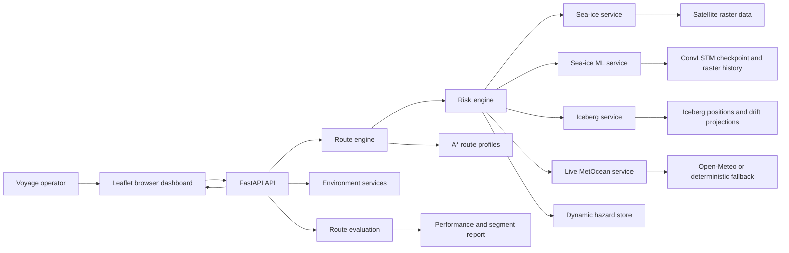

# IndraSetu Architecture and User Workflow

## 1. Purpose

IndraSetu is an Antarctic maritime decision support application. It combines satellite sea-ice observations, sea-ice forecasting, iceberg drift tracks, live or synthesized MetOcean conditions, dynamic hazards, and vessel capability to produce risk-aware voyage routes.

The system supports three related decisions:

1. Plan a voyage between a departure port and an Antarctic destination.
2. Compare route profiles by safety, balance, and fuel efficiency.
3. Recalculate the remaining route when conditions change during a voyage.

The application is a decision support system. It provides route recommendations and evidence for voyage command review. It does not replace navigation officers, official charts, or regulated safety procedures.

## 2. System Overview

The system has a browser dashboard, a FastAPI backend, domain services, machine learning components, and local data assets.



### Runtime entry points

- `run.py` starts Uvicorn on `127.0.0.1:8000` with reload enabled.
- `backend/main.py` creates the FastAPI application and wires all services.
- `frontend/index.html` is served by the backend at `/` and contains the dashboard, styles, map, and browser-side logic.

### 2.1 Technology stack

| Layer | Technology used | Role |
| --- | --- | --- |
| User interface | HTML5, CSS3, JavaScript | Single page mission dashboard and interaction logic. |
| Mapping | Leaflet 1.9.4 | Antarctic map, route polylines, markers, popups, circles, and layer controls. |
| Heatmap rendering | Leaflet.heat 0.2.0 | Sea-ice concentration density visualization. |
| Backend API | Python, FastAPI | Typed HTTP API and application composition. |
| ASGI server | Uvicorn | Local development server and request handling. |
| Validation | Pydantic 2 | Request schemas, field bounds, and input validation. |
| Numerical computing | NumPy, SciPy | Raster operations, interpolation, geographic arrays, and fallback calculations. |
| Deep learning | PyTorch | ConvLSTM sea-ice forecasting and GRU iceberg displacement prediction. |
| Classical machine learning | scikit-learn Random Forest Regressor | Fast fallback point-risk model. |
| Data preparation | pandas, xarray, tqdm | CSV, NetCDF-style scientific data, preprocessing, and progress reporting. |
| Geospatial support | pyproj and custom haversine functions | Coordinate conversion support and nautical-mile distance calculations. |
| External data | Open-Meteo API, NOAA/NSIDC-derived raster assets | Live weather and satellite sea-ice inputs. |
| Testing | pytest, unittest, Starlette TestClient | Service, route engine, and API contract tests. |
| Persistence | NumPy arrays, PyTorch checkpoints, CSV files, browser localStorage | Model assets, processed datasets, and client-side resilience cache. |

The runtime application is intentionally lightweight. The frontend is served by the same FastAPI process, while the trained models and processed arrays are loaded from the local project directories at startup.

## 3. Component Architecture

### 3.1 Frontend dashboard

The frontend is a single HTML page using Leaflet and Leaflet Heat. It provides:

- A map centered on Antarctic waters.
- Origin, destination, departure date, and vessel class controls.
- Satellite sea-ice heatmap controls and palette selection.
- Iceberg markers and 24, 48, and 72 hour drift lines.
- Dynamic hazard circles.
- Live wind, wave, sea-ice, and risk telemetry.
- Three selectable route result cards.
- Voyage simulation with a moving vessel marker.
- A one-minute rerouting watchdog.
- Route evaluation results with fuel, cost, emissions, hull stress, and segment risk.

The browser caches environment layers, heatmap data, and calculated routes in `localStorage`. When the network is unavailable, cached results remain visible where available and the interface reports offline or edge simulation mode.

### 3.2 FastAPI application layer

`backend/main.py` is the composition root. It creates one instance of each service and exposes the HTTP contract:

| Endpoint | Method | Responsibility |
| --- | --- | --- |
| `/api/environment/layers` | GET | Returns sea-ice zones, iceberg tracks, and active hazards. |
| `/api/sea-ice/heatmap` | GET | Returns spatial sea-ice concentration points for the map. |
| `/api/live/environmental-data` | GET | Returns MetOcean data and a coordinate risk breakdown. |
| `/api/live/hazard/trigger` | POST | Adds a dynamic hazard to the active in-memory hazard list. |
| `/api/sea-ice/forecast` | POST | Runs or retrieves a sea-ice forecast summary. |
| `/api/routes/calculate` | POST | Calculates the three initial route profiles. |
| `/api/routes/reroute` | POST | Calculates the remaining path from the vessel position. |
| `/api/routes/evaluate` | POST | Produces a detailed voyage performance report. |

Pydantic request models validate route coordinates, vessel settings, dates, and dynamic hazard inputs before service execution. CORS is enabled for the dashboard and development integrations.

### 3.3 Sea-ice observation service

`SeaIceService` loads processed arrays from `Sea ice prediction/data/processed` when they exist:

- `sic.npy` contains sea-ice concentration observations.
- `dates.npy` identifies observation dates when available.
- `lat.npy` and `lon.npy` provide the geographic grid.

The service selects the nearest grid cell for point risk lookup. Heatmap requests select the closest observation date, downsample the grid using a stride, remove invalid or low-concentration points, and return map-ready latitude, longitude, and concentration values.

If the processed arrays are unavailable, the service uses a deterministic polar fallback model. This keeps the application usable while making the data source explicit in the response.

### 3.4 Sea-ice ML service

`SeaIceMLService` loads the trained `SeaIceConvLSTM` checkpoint from `Sea ice prediction/checkpoints/best_model.pt` when present. It prepares a seven-day sequence, handles missing values with validity masks, resizes the input to a 128 by 128 grid, and runs inference on CUDA when available or CPU otherwise.

Forecasts are stored in memory. Risk lookups reuse the loaded prediction and select the nearest geographic grid cell. Requested dates are matched to the nearest available observation date when an exact date is not present.

If the model or source data is unavailable, the service creates a deterministic seasonal and latitude-based forecast instead of failing application startup.

### 3.5 Iceberg service

`IcebergService` stores tracked iceberg records with position, size, drift direction, and speed. It projects positions at 24, 48, and 72 hours using a simple spherical approximation. The service also provides a proximity risk score that increases as a route cell approaches a tracked iceberg.

The current implementation uses the configured in-process iceberg records. It is therefore a replaceable boundary for a future live iceberg feed.

### 3.6 Live MetOcean and hazard service

`LiveEnvironmentService` requests current weather values from Open-Meteo with a short timeout. The response is converted into navigation fields such as wind speed, wind direction, visibility, wave height, wave direction, air temperature, and surface pressure.

When the external request fails, a deterministic polar physics approximation supplies a stable fallback. Successful responses are cached per rounded coordinate for five minutes.

Dynamic hazards are held in memory. Each hazard has a position, radius, severity, type, description, and creation time. A point inside a hazard radius receives a distance-weighted risk contribution. New hazards can be injected through the API during a simulated or active voyage.

### 3.7 Risk engine

`RiskEngine` is the shared risk abstraction used by route search, live inspection, and route evaluation. For every coordinate it combines:

- Sea-ice risk from the sea-ice ML service, with a Random Forest fallback model.
- Tracked iceberg proximity risk.
- Wind, wave, and visibility risk from MetOcean data.
- Active dynamic hazard risk.
- Vessel capability attenuation.

The base composite risk is calculated as:

```text
raw risk = (0.40 * sea-ice risk
          + 0.25 * iceberg risk
          + 0.15 * weather risk
          + 0.20 * dynamic hazard risk) * vessel factor
```

The result is clamped to the range 0 to 1. Polar Class 1 reduces the risk factor, Polar Class 4 applies a moderate reduction, and Standard vessels increase the risk factor.

### 3.8 Route engine

`RouteEngine` searches a rounded Antarctic coordinate lattice with A*. Neighboring cells are spaced by 1.5 degrees latitude and 3 degrees longitude. The search is limited to latitudes from -82 to -50 and stops after 2,500 visited nodes.

Each edge cost combines distance and risk:

```text
edge cost = distance * (1 + route risk weight * risk squared * 8)
```

The engine runs the search three times with different risk weights:

| Profile | Risk weight | Intended tradeoff |
| --- | ---: | --- |
| Safest | 15.0 | Accepts additional distance to reduce hazard exposure. |
| Balanced | 3.5 | Balances distance, fuel, and hazard exposure. |
| Fuel Efficient | 0.2 | Follows a shorter path while accepting more risk. |

Route metrics include distance, estimated duration, fuel consumption, average risk, waypoints, and a profile explanation. Speed is reduced as average risk increases, and vessel type affects the base speed.

### 3.9 Route evaluation

The evaluation service analyzes a selected route segment by segment. It calculates:

- Voyage Performance Index.
- Total distance and estimated duration.
- Fuel consumption and estimated fuel cost.
- CO2 emissions.
- Hull stress index.
- Average total, sea-ice, and iceberg risk.
- Percentage of the corridor in a high-risk tier.
- A tactical briefing.

Each segment is labeled `LOW RISK`, `MODERATE EXPOSURE`, or `HIGH HAZARD` based on its composite risk.

### 3.10 Model and algorithm details

#### Sea-ice forecast model: masked ConvLSTM

The sea-ice model is a two-layer convolutional Long Short-Term Memory network. It is designed for spatially structured daily sea-ice concentration rather than tabular point features.

Input and output shapes are:

```text
Input:  (batch, 7 days, 1 channel, 128 rows, 128 columns)
Output: (batch, 1 channel, 128 rows, 128 columns)
```

The architecture contains:

- ConvLSTM cell 1: 1 input channel and 16 hidden channels.
- ConvLSTM cell 2: 16 input channels and 16 hidden channels.
- A 1 by 1 convolutional prediction head.
- A sigmoid output so predicted concentration remains in the range 0 to 1.
- A 3 by 3 convolution in each recurrent cell with same-padding behavior.

Each ConvLSTM cell calculates input, forget, output, and candidate gates. The recurrent state preserves temporal information while the convolution preserves the spatial neighborhood structure of the ice field.

Training uses seven consecutive daily frames to predict the next frame. Sequences containing date gaps are excluded. NaN and infinite values are replaced for tensor processing, while a validity mask prevents missing or invalid pixels from contributing to the loss.

The training configuration is:

| Setting | Value |
| --- | ---: |
| Optimizer | AdamW |
| Learning rate | 0.001 |
| Weight decay | 0.00001 |
| Epoch limit | 20 |
| Batch size | 2 |
| Hidden channels | 16 per recurrent layer |
| Loss | Validity-masked mean squared error |
| Selection rule | Lowest validation loss |
| Hardware | CUDA when available, otherwise CPU |

The forecast evaluator reports pixel-level MAE and RMSE and compares both against a persistence baseline. The persistence baseline uses the previous observed frame as the next prediction. It also reports percentage improvement over persistence for MAE and RMSE.

#### Iceberg trajectory model: GRU displacement predictor

The repository also contains a separate trajectory model for learned iceberg motion. The current model class is a two-layer GRU followed by a fully connected regression head.

Input and output shapes are:

```text
Input:  (batch, 7 observations, 5 features)
Output: (batch, 3 horizons, 2 displacement values)
```

The five input variables are:

| Feature | Meaning | Unit or representation |
| --- | --- | --- |
| `latitude` | Iceberg latitude at an observation time | Degrees |
| `longitude` | Iceberg longitude at an observation time | Degrees |
| `delta_lat` | Change in latitude from the previous observation | Degrees |
| `delta_lon` | Change in longitude from the previous observation | Degrees |
| `speed_kmh` | Estimated movement speed | Kilometers per hour |

The sequence builder uses seven consecutive observations and predicts north and east displacement for 1-day, 2-day, and 3-day horizons. Geographic displacement is calculated on an Earth sphere using an Earth radius of 6371.0088 km. The dataset is split by iceberg identity, not by random rows, to reduce identity leakage between train, validation, and test sets. The intended split is 70 percent train, 15 percent validation, and 15 percent test.

The GRU configuration is:

| Setting | Value |
| --- | ---: |
| Input features | 5 |
| Hidden size | 128 |
| Recurrent layers | 2 |
| Dropout | 0.15 between recurrent layers |
| Regression head | 128 to 64 ReLU to 6 outputs |
| Optimizer | AdamW |
| Learning rate | 0.001 |
| Weight decay | 0.0001 |
| Batch size | 256 |
| Epoch limit | 40 |
| Loss | Smooth L1 loss |
| Scheduler | ReduceLROnPlateau, factor 0.5, patience 3 |
| Early stopping | Patience 7 |
| Gradient control | Norm clipping at 1.0 |

Inputs are normalized using the training-set mean and standard deviation. The checkpoint stores the model weights, normalization statistics, and validation loss.

The trajectory evaluator reconstructs predicted and actual positions from displacement and reports mean absolute error, root mean square error, median error, and comparison with a persistence baseline. Errors are measured using great-circle distance in kilometers. The evaluator also prints ADE and FDE fields for trajectory reporting. In the current script those two fields use the mean and median of the computed trajectory error respectively, so they should be interpreted as project-specific summary values rather than the conventional average and final displacement error definitions.

The live `IcebergService` currently exposes configured tracked iceberg records and deterministic 24, 48, and 72 hour drift projections. The trained GRU is available in the trajectory ML workspace, but the live route API does not yet call the GRU checkpoint. Integrating the GRU into `IcebergService` is a future production extension.

#### Point-risk fallback model: Random Forest

When a sea-ice ML prediction is not available, `PolarMLRiskModel` trains a small Random Forest Regressor during backend initialization. It uses 800 deterministic synthetic samples generated with seed 42.

The five model variables are:

| Variable | Meaning |
| --- | --- |
| Latitude | Geographic latitude in the Antarctic operating range. |
| Longitude | Geographic longitude. |
| Month | Integer month from 1 to 12. |
| Estimated surface temperature | Derived temperature proxy. |
| Estimated wind speed | Derived wind proxy in knots. |

The fallback model uses 15 trees, maximum depth 5, one worker, and a fixed random state of 42. Predictions are memoized for rounded latitude and longitude values with an LRU cache of 8,192 entries. This model is intended to provide fast continuity, not to replace the trained raster forecast.

### 3.11 Feature variables and data contracts

The main environmental variables used in the application are:

| Variable | Source | Used for |
| --- | --- | --- |
| Sea-ice concentration | Satellite raster or forecast model | Primary ice resistance and route risk. |
| Latitude and longitude | Request, raster grid, or track data | Grid lookup, distance, routing, and spatial joins. |
| Observation date and departure date | Raster metadata and route request | Selecting an observation and seasonal model behavior. |
| Wind speed | Open-Meteo or fallback weather model | Weather risk and wave proxy. |
| Wind direction | Open-Meteo or fallback weather model | Telemetry and map display. |
| Wave height | Open-Meteo-derived or fallback value | Weather risk and telemetry. |
| Wave direction | Derived from wind direction | Telemetry. |
| Visibility | Open-Meteo or fallback weather model | Weather risk. |
| Air temperature | Open-Meteo or fallback weather model | Telemetry and model context. |
| Surface pressure | Open-Meteo or fallback weather model | Telemetry and model context. |
| Iceberg position, size, direction, and speed | Tracked iceberg records | Drift display and proximity risk. |
| Hazard radius and severity | Dynamic hazard request | Distance-weighted active hazard risk. |
| Vessel type | User route request | Risk attenuation and base speed. |
| Route profile | User selection | A* risk weight and fuel rate. |

The main API response contracts are JSON objects containing either map-ready layers, a risk breakdown, route alternatives, reroute state, or route evaluation metrics. Waypoints are represented as `[latitude, longitude]` pairs. GeoJSON polygon coordinates are converted to `[longitude, latitude]` order where required by the GeoJSON standard.

### 3.12 Risk and routing formulas

The weather risk model first normalizes wind, waves, and visibility:

```text
wind penalty = min(1, wind speed in knots / 50)
wave penalty = min(1, wave height in meters / 8)
visibility penalty = max(0, 1 - visibility in km / 15)
```

It combines those values with a latitude-centered storm-belt term to produce a bounded weather risk. The final risk fusion is:

```text
composite risk = clamp(
    (0.40 * sea-ice risk
   + 0.25 * iceberg risk
   + 0.15 * weather risk
   + 0.20 * dynamic hazard risk) * vessel factor,
   0,
   1
)
```

The route engine uses the haversine distance with an Earth radius of 3440.065 nautical miles. For every candidate edge it calculates:

```text
edge cost = distance in NM
          * (1 + profile risk weight * composite risk^2 * 8)
```

The squared risk term makes high-risk cells disproportionately expensive. The A* heuristic is the haversine distance from the candidate node to the destination. The search accepts a node when it is within 120 nautical miles of the rounded destination coordinate, then appends the destination as the final waypoint.

Route performance metrics use a distance-weighted average risk:

```text
average risk = sum(segment risk * segment distance) / total distance
effective speed = base speed * (1 - 0.45 * average risk)
estimated hours = total distance / max(effective speed, 4)
fuel in metric tons = estimated hours * profile fuel rate
```

The evaluation report adds:

```text
fuel cost = fuel in metric tons * 650 USD
CO2 mass = fuel in metric tons * 3.114
hull stress index = 1 + 2.5 * average sea-ice risk
high-risk ratio = high-risk distance / total distance * 100
VPI = clamp(100 - 0.45 * average risk * 100 - 0.003 * distance, 10, 99)
```

These are planning indices and estimates. They are not certified fuel performance, emissions accounting, or structural engineering calculations.

### 3.13 Metrics and observability

#### Model metrics

- Sea-ice forecast: masked validation MSE, pixel MAE, pixel RMSE, and improvement against persistence.
- Iceberg trajectory: displacement MAE, displacement RMSE, median great-circle error, persistence comparison, and project-specific ADE and FDE summaries.
- Risk model: bounded component risks and composite risk from 0 to 1.

#### Route metrics

- Total distance in nautical miles.
- Estimated hours and days.
- Fuel consumption in metric tons.
- Overall and component risk percentages.
- Remaining distance, remaining time, and remaining fuel after rerouting.
- High-risk corridor ratio.
- Voyage Performance Index from 10 to 99.
- Hull stress index.
- Fuel cost and estimated CO2 mass.

#### Data quality and runtime indicators

- Source label for live or fallback MetOcean data.
- Whether MetOcean data is live or synthesized.
- Satellite observation date and source label.
- Number of heatmap points returned.
- Mean and maximum sea-ice concentration.
- Estimated ice extent in square kilometers.
- Current active hazard count through the environment layer response.
- Route search iteration limit of 2,500 visited nodes.
- MetOcean cache lifetime of 300 seconds per rounded coordinate.
- Dynamic hazard retention limit of 500 recent hazards.

The current application returns these values in API responses and displays the most operationally relevant subset in the dashboard. It does not yet export structured logs, traces, model latency, request latency, or production monitoring time series.

## 4. End-to-End User Workflow

### 4.1 Open the mission dashboard

1. The operator starts the application with `python run.py`.
2. The browser opens the dashboard at `http://127.0.0.1:8000`.
3. The dashboard loads map tiles, environment layers, satellite heatmap data, and cached data listeners.
4. The status indicator reports live connectivity, offline cache use, or edge simulation mode.

### 4.2 Inspect the operating environment

1. The operator reviews sea-ice concentration on the heatmap.
2. Ice zones, tracked iceberg positions, drift forecasts, and active hazard circles appear on the map.
3. The operator can switch between thermal and polar heatmap palettes or turn the heatmap off.
4. Clicking an Antarctic map position requests live environmental data for that coordinate.
5. The popup shows estimated sea-ice, iceberg, and weather risk for the selected location.

### 4.3 Generate route options

1. The operator chooses an origin port and destination base.
2. The operator selects a departure date and vessel class.
3. The dashboard displays progress states for forecast loading, satellite data, A* search, and route synthesis.
4. The backend evaluates route cells through the risk engine while A* searches for paths.
5. The dashboard draws the Safest, Balanced, and Fuel Efficient corridors.
6. The Safest corridor is selected initially, and the map fits the visible route bounds.

### 4.4 Compare and evaluate a route

1. The operator selects a route card to change the active profile.
2. The map emphasizes the selected route and reduces the visual weight of the other routes.
3. The operator opens the evaluation report for the active route.
4. The backend calculates voyage performance, fuel, cost, emissions, hull stress, and segment risk.
5. The operator reviews the tactical briefing and segment breakdown before approving a route for simulation or operational review.

### 4.5 Monitor an underway voyage

1. The operator starts voyage simulation for the active route.
2. The vessel marker advances along the selected waypoints.
3. The dashboard updates position, estimated remaining distance, heading, MetOcean values, and forward risk.
4. A 60-second watchdog requests an en-route reroute check.
5. The operator can also request a manual check at any time.

### 4.6 Respond to a changing hazard

1. A dynamic hazard can be reported through the hazard API. The dashboard also provides a simulation control that injects a drifting iceberg ahead of the vessel.
2. The hazard is added to the active in-memory hazard list and rendered on the map.
3. The risk engine includes the hazard in cell risk calculations.
4. The route engine searches from the current position to the destination using the active route profile.
5. If the current risk exceeds the alert threshold, the dashboard shows a detour warning.
6. The operator applies the proposed detour, which replaces the remaining route while preserving the traveled waypoints.

## 5. Data and Model Lifecycle

The project contains separate data and model workspaces for sea ice and iceberg trajectories. Training and preprocessing scripts live under `Sea ice prediction/src` and `iceberg trajectory/src`. Trained checkpoints are stored under the corresponding `checkpoints` directories.

At runtime, the backend loads model and raster assets during application initialization. The route engine then consumes point-level risk requests instead of loading model files for every route cell. Live MetOcean results are cached, and the frontend caches map and route responses locally.

This design keeps the interactive path simple: load assets once, compute risk at route cells, return compact JSON, and let Leaflet handle visualization.

## 6. Resilience and Failure Behavior

- Missing sea-ice arrays use a deterministic heatmap fallback.
- Missing sea-ice model assets use a deterministic forecast fallback.
- Open-Meteo failures use a deterministic MetOcean fallback.
- Browser network failures use cached environment, heatmap, and route data when available.
- Dynamic hazards remain available for the current backend process and are capped at the most recent 500 entries.
- Route search raises an error when it cannot find a route before its iteration limit. The frontend then attempts to show a cached route or displays an error toast.

## 7. Verification Approach

The tests in `tests` cover the main operational contracts:

- Live environmental response fields.
- Absolute iceberg trajectory horizons.
- Dynamic hazard injection and risk contribution.
- En-route reroute generation.
- Route evaluation metrics.
- Live data, reroute, evaluation, hazard, and sea-ice forecast API endpoints.

A typical local verification command is:

```text
pytest
```

## 8. Current Boundaries and Future Extensions

The current system is designed as a demonstrable technical prototype with clear replacement points. The following areas would be appropriate for production hardening:

- Replace in-process iceberg records with a verified operational iceberg feed.
- Persist dynamic hazards in a shared store so multiple operators see the same state.
- Add authentication, authorization, audit logging, and rate limiting to the API.
- Replace synthetic fallbacks with explicit data quality and source health policies.
- Add geodesic validation, nautical chart constraints, bathymetry, protected areas, and regulated navigation rules.
- Move long route searches and forecast inference to managed background jobs if request volume grows.
- Add versioned model metadata and data provenance to every route result.
- Add integration tests for frontend rendering and offline recovery.

## 9. Summary

IndraSetu uses a layered architecture in which the dashboard handles operator interaction, FastAPI exposes stable application contracts, domain services provide environmental data, the risk engine normalizes hazards into a common score, and the route engine turns those scores into route alternatives. The user workflow moves from environmental inspection to route planning, route evaluation, voyage monitoring, and dynamic rerouting when new hazards appear.